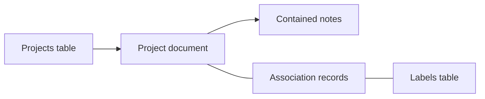

# Generated resource HTTP routes

Register a Collection to expose its resource operations. Web handlers validate requests and shape HTTP responses; controllers manage resources, embedded values, associations and output. The runtime remains one Bun process with Hono, Zod and the configured backend.

The [Tenant API](tenants.md) is built in and uses the configuration catalogue without application collection registration.

## Define root and contained collections

Use `Resource` for every identifiable item. A Collection without `parent` has its own storage and root routes. A Collection with `parent` stores its items inside the parent document and has nested routes. Both have server-managed UUIDs and ISO creation/update timestamps. The parent's model explicitly describes a single contained value, array or dictionary.

```ts
import { z } from 'zod'

import { Collection, Hedra, Resource, SqliteBackend } from '#hedra.ts'

const Note = Resource.extend({ text: z.string().trim().min(1) })
const Label = Resource.extend({ name: z.string().min(1) })
const Project = Resource.extend({
  title: z.string().min(1),
  notes: z.array(Note).default([]),
  namedNotes: z.record(z.string(), Note).default({}),
  summary: Note.optional(),
})
const labels = new Collection('labels', Label)
const projects = new Collection('projects', Project, { associations: [labels] })

new Collection('notes', Note, { parent: projects })
new Collection('namedNotes', Note, { parent: projects })
new Collection('summary', Note, { parent: projects })

const backend = new SqliteBackend(':memory:')
const app = new Hedra({ backend })

app.register(projects)
```

Declare children before registration. Registering the root or one of its children discovers the complete declared tree and the referenced independent labels collection. Notes remain in each project's JSON document, so `/notes` is absent and no notes table is used.

The child's collection name must name a direct field on the parent model, and its model must be the same item schema. Use a direct Resource field, `z.array(ResourceModel)` or `z.record(keySchema, ResourceModel)`, with optional/nullable/default wrappers as needed. A child can declare its own children the same way. Embedding Resource schemas through ordinary wrapper objects, nested arrays, unions or lazy schemas rejects. Ordinary nested Zod objects are document data without managed resource metadata. A nested Resource field receives no generated routes until a corresponding parent-declared Collection exists.



The SQLite backend stores the complete document in its JSON `data` column; child fields do not become separate SQL columns. Child filters operate within the addressed parent. Global child search and secondary-index declarations are not provided. See [storage and query costs](backends.md#contained-storage-and-query-costs).

The following requests continue the definition above. Close the app and its borrowed backend when finished. For a complete executable version, run `bun run examples/06-embedded-resources.ts` from the repository root.

## Requests and responses

| Path | Methods | Response |
| --- | --- | --- |
| `/projects` | GET, POST | List/create independent resources. |
| `/projects/:projectId` | GET, PATCH, DELETE | Read/update/delete one independent resource. |
| `/projects/:projectId/notes` | GET, POST | List/create embedded array items. |
| `/projects/:projectId/notes/:noteId` | GET, PATCH, DELETE | Address an array item by its UUID. |
| `/projects/:projectId/namedNotes` | GET, POST | List/create dictionary entries. POST requires `?key=brief`. |
| `/projects/:projectId/namedNotes/:key` | GET, PATCH, DELETE | Address a dictionary entry by its key. |
| `/projects/:projectId/summary` | GET, POST, PATCH, DELETE | Address the single embedded value. POST requires it to be absent. |
| `/projects/:projectId/labels` | GET, POST | List associated labels, or create and associate a new label. |
| `/projects/:projectId/labels/:labelId` | GET, PATCH, DELETE | Address a label through its association. |
| `/projects/:projectId/associations/labels/:labelId` | DELETE | Remove the association without deleting either endpoint. |
| `/labels`, `/labels/:labelId` | Ordinary CRUD methods | Canonical access to independent labels. |

POST and PATCH accept a JSON attribute object, with a JSON content type. Successful POST returns 201 and a Location header. GET/PATCH return 200. Successful DELETE returns 204 with no body.

Single responses use `JsonApiResponse`: flat attributes in `data` and a self link. Ordinary and array lists use array data. Dictionary lists use dictionary data, retaining their keys. A dictionary value still has its own UUID; that UUID does not replace its key in the path. Encode keys in URLs. Keys must be nonempty, satisfy the model's key schema and differ from `.`, `..` and the reserved `__proto__` key.

Every ancestor must exist. A contained item under another owner, or an independent resource without the association named by a navigation path, returns 404. Each contained route dispatches to that child's selected controller with the child Collection. The containing root and traversal remain internal; custom controllers use the [public resource scope](collections.md#resource-scope) before delegating to BaseController.

| Status | Cause |
| --- | --- |
| 400 | Malformed JSON. |
| 404 | Missing resource, ancestor, embedded item or association. |
| 409 | An occupied dictionary/single-value create target, or associations blocking Resource deletion. |
| 415 | Unsupported request content type. |
| 422 | Invalid attributes, item identifiers, dictionary keys, query options or resulting required/container constraints. |
| 500 | An internal or output-validation failure. |

Generated-route errors follow the exported `ErrorResponse` schema: an `errors` envelope with status, title and optional detail. Deletion conflicts report blocking association references rather than private resource attributes. Internal failures never return unfiltered resource data.

## Filters

Pass one JSON `filter` query parameter. `URLSearchParams` encodes it safely:

```ts
const query = new URLSearchParams({ filter: JSON.stringify({ title: 'Launch' }) })
const response = await app.request(`/projects?${query}`)
```

Filters use equality on declared public scalar fields, and all criteria must match. JSON keeps strings, numbers, booleans and null distinct. Duplicate filter parameters, undeclared/private fields, nested filter values and unsupported query options reject. Absent filter fields do not acquire defaults. Pagination, sorting and comparison operators are not provided.

## Replacing embedded values

Creating a parent can supply embedded values without metadata; the controller generates metadata throughout the new document. Supplied managed metadata does not override server values.

PATCH preserves omitted parent attributes. Supplying an embedded container replaces that container. Use a nested item PATCH to change one item's supplied attributes while retaining its other attributes.

An absent or null array/dictionary lists as empty. A nested POST initializes that container before inserting the new item; the resulting document must still pass its model. Single-value POST likewise requires an absent or null value.

| Container | Replacement identity |
| --- | --- |
| Array | Supply an existing item's ID to retain its identity/creation timestamp. An ID-less item is new. Omitted items are removed; `[]` removes every item. |
| Dictionary | An existing ID or an unchanged key retains identity. An existing ID can retain identity when its key changes. Omitted keys are removed; `{}` clears the dictionary. |
| Single value | Replacing an existing value retains its identity. An absent value receives a new identity when created. |

Replacement entries provide their complete ordinary attributes; omitted optional attributes are removed. IDs from outside that containing container, duplicate IDs and mismatched single-value IDs reject the entire update. Supplied timestamps cannot change managed timestamps. Replacement rules apply recursively.

An embedded mutation updates the affected item and its containing resource ancestors. Unaffected siblings retain their timestamps. The controller validates the complete containing resource inside the transaction, including cross-field rules, requiredness and container constraints. Deleting a required single value or the final item from a nonempty array fails without changing storage. A failed validation, projection or storage operation leaves the entire parent unchanged. See the [atomic validation decision](adr/0012-atomic-candidate-validation.md).

## Associations and deletion

An association connects independent Resources, each retaining its storage and lifetime. A nested path provides navigation. It does not create ownership or a private copy of the associated resource. The same resource can be associated with several parents.

POST to `/projects/:projectId/labels` creates a label and its association in one transaction. With the IDs of existing resources, link them through the programmatic interface:

```ts
await app.associations.link(
  { collection: 'projects', id: projectId },
  { collection: 'labels', id: labelId },
)

const associations = await app.associations.list({ collection: 'labels', id: labelId })
```

Both endpoints must exist and use a declared association between registered independently stored collections. A contained collection cannot declare or receive associations. Linking the same pair is idempotent. An HTTP endpoint for linking existing resources is deferred.

**Any association blocks deletion of either endpoint.** Resource DELETE returns 409 with the blocking associations, even when invoked through a nested association path. Remove each link, then delete the resource through its canonical route:

```ts
await app.request(`/projects/${projectId}/associations/labels/${labelId}`, { method: 'DELETE' })
await app.request(`/labels/${labelId}`, { method: 'DELETE' })
```

The programmatic equivalent is `app.associations.unlink(source, target)`. Unlinking retains both Resources and unrelated associations. After unlinking, the old navigation path returns 404, while canonical resource access remains available. If other links remain, deletion continues to return 409.

Embedded ownership is separate: embedded values do not block deletion of their owner and disappear with it. Independent associated Resources are never deleted as a cascade. Cardinality and exclusivity policies remain deferred.

## Public fields and lifecycle

Default projection strips unknown fields and password fields at every Resource level. The containing root's output validator defines the public fields for its whole document, including child endpoints. Child output is derived from that containing definition; a separate `outputValidator` on a parent-declared Collection rejects. Hidden fields receive no exposing generated routes. Projection failures abort writes instead of returning raw data. See [public output](collections.md#public-output).

Output transformations must retain resource identity and the correspondence between a dictionary key and its embedded item. Remapping a key to another item's UUID is an output error, including when its declared schema still accepts the result; it cannot commit a write or return the wrong item.

Closing Hedra invalidates saved controllers and association handles. An owned backend closes with the app; a borrowed backend remains the creator's responsibility. Association operations use the [generic transaction interface](backends.md#transactions-across-records).

This interface supplies no cookies, middleware, authentication or tenant selection. Use the existing Hono interface for other application routes. See the [parent-collection decision](adr/0029-parent-declared-contained-collections.md) for storage and lifetime rules.
